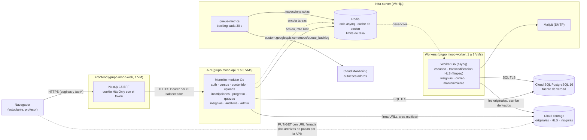
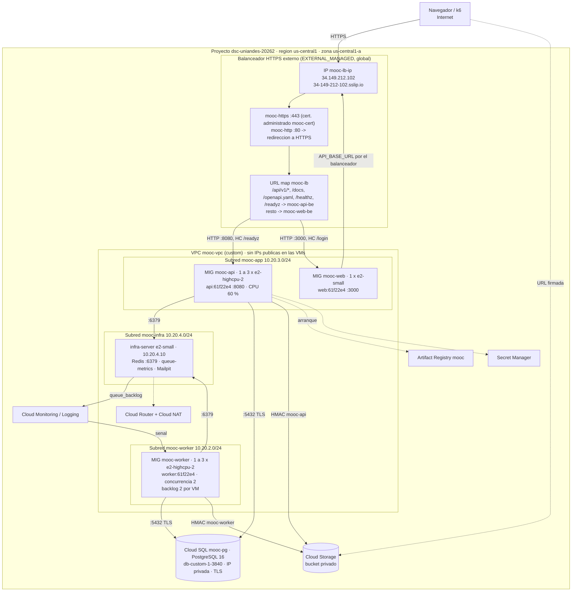

# Entrega 3 - Arquitectura elástica en Google Cloud

ISIS4426 - Desarrollo de Soluciones Cloud · Universidad de los Andes · 2026-20

Este documento describe la solución **efectivamente desplegada** en Google
Cloud para la Entrega 3 y los cambios frente a la Entrega 2. Los valores
provienen de los recursos del proyecto `dsc-uniandes-20262`, consultados el
31-10-2026 con `gcloud` y con la API de Compute Engine.

La arquitectura lógica de la aplicación no cambia y sigue en
[`../entrega1/ARQUITECTURA.md`](../entrega1/ARQUITECTURA.md): módulos, reglas
de negocio y modelo de datos. La guía de trabajo del equipo, con más detalle
didáctico, está en [`guia-mig.md`](guia-mig.md).

Documentos relacionados:

- Pruebas de capacidad: [`capacity-planning/pruebas_de_carga_entrega3.md`](../../capacity-planning/pruebas_de_carga_entrega3.md)
- Verificación del frontend: [`FuncionalidadFront/verificacion-frontend.md`](FuncionalidadFront/verificacion-frontend.md)
- Deuda técnica: [`deuda-tecnica.md`](deuda-tecnica.md)

## 1. Cambios frente a la Entrega 2

| Componente | Entrega 2 | Entrega 3 (desplegado) |
|---|---|---|
| API | 1 VM fija `web-server` (`e2-highcpu-2`) con API, frontend, Caddy y monitoreo | Grupo administrado `mooc-api`, **1 a 3** VMs `e2-highcpu-2`, autoescalado por CPU, solo la API |
| Acceso | Caddy con Let's Encrypt en la IP de `web-server` | **Balanceador HTTPS externo** de Google con certificado administrado y verificaciones de salud |
| Frontend | Contenedor en `web-server` | Grupo `mooc-web`, 1 VM `e2-small`, detrás del mismo balanceador |
| Workers | 1 VM fija `worker-server`, `WORKER_CONCURRENCY=4` | Grupo administrado `mooc-worker`, **1 a 3** VMs `e2-highcpu-2`, autoescalado por trabajos en cola, `WORKER_CONCURRENCY=2` por VM |
| Cola | Redis en `worker-server` | Redis en **`infra-server`**, VM fija fuera de los grupos, compartida por todas las réplicas |
| Inicialización | `startup.sh` instala Docker; el equipo copia los `.env` por SSH y hace `docker compose up --build` | **Automática**: plantilla de instancia, `startup.sh` lee rol y versión de los metadatos, el secreto de Secret Manager y la imagen versionada de Artifact Registry |
| Imágenes | Construidas en cada VM | Construidas una vez (`build.sh`) y etiquetadas con el commit en **Artifact Registry** |
| Secretos | `/etc/mooc/*.env` copiados a mano | **Secret Manager** (`mooc-<rol>-env`), leídos por la identidad de la VM al arrancar |
| Persistencia | Cloud SQL y Cloud Storage | **Igual**, compartidos por todas las réplicas |
| Señal de autoescalado de workers | — | `custom.googleapis.com/mooc/queue_backlog`, publicada por `queue-metrics` |

**Cambios en el backend** (rama `entrega-3-infra`, commit `cd9a98d`): ninguno
en las reglas de negocio. Solo se ajustó la ejecución con réplicas:

- pool de Postgres configurable por rol (`DB_MAX_OPEN_CONNS`);
- IP real del cliente detrás del balanceador (`TRUSTED_PROXIES`);
- cabecera `X-Instance-Id` con el nombre de la VM;
- apagado ordenado del worker (`WORKER_SHUTDOWN_TIMEOUT_SECONDS`);
- un trabajo interrumpido no marca el archivo como fallido (`interrupted`, en
  `internal/tasks/tasks.go`).

Se agregó el proceso `cmd/queue-metrics`.

## 2. Correspondencia entre el enunciado y los servicios de GCP

| Requisito | Servicio | Recurso |
|---|---|---|
| Grupo de API de 1 a 3 instancias con autoescalado | Compute Engine MIG zonal + autoescalador | `mooc-api`, autoescalador `mooc-api-bcf6` |
| Grupo de workers de 1 a 3 instancias con autoescalado | Compute Engine MIG zonal + autoescalador por métrica | `mooc-worker`, autoescalador `mooc-worker-yiah` |
| Plantilla e inicialización automática | Plantillas de instancia + `startup-script` | `mooc-{api,worker,web}-tpl-61f22e4`, [`deploy/gcp/mig/startup.sh`](../../deploy/gcp/mig/startup.sh) |
| Balanceador externo con HTTPS | Application Load Balancer externo global (`EXTERNAL_MANAGED`) | `mooc-https`, `mooc-https-proxy`, `mooc-lb`, `mooc-cert` |
| Verificaciones de salud | Health checks globales | `mooc-hc-api-lb`, `mooc-hc-api-vida`, `mooc-hc-worker-vida`, `mooc-hc-web` |
| Cola compartida fuera de los grupos | VM dedicada con Redis | `infra-server` (10.20.4.10) |
| PostgreSQL administrado | Cloud SQL | `mooc-pg` |
| Almacenamiento de objetos | Cloud Storage | `gs://mooc-dsc-uniandes-20262` |
| Versión identificable de las imágenes | Artifact Registry | `us-central1-docker.pkg.dev/dsc-uniandes-20262/mooc/{api,worker,web,queue-metrics}:61f22e4` |
| Obtención segura de secretos | Secret Manager | `mooc-api-env`, `mooc-worker-env`, `mooc-web-env`, `mooc-infra-env` |
| Identidades con permisos mínimos | Cuentas de servicio | `mooc-api`, `mooc-worker`, `mooc-web`, `mooc-infra` |
| Métricas y registros | Cloud Monitoring, Cloud Logging, Ops Agent | Métricas por VM, `queue_*`, logs `gcplogs-docker-driver` y `google_metadata_script_runner` |

## 3. Modelo de componentes

Fuente: [`diagramas/componentes.mmd`](diagramas/componentes.mmd).



| Componente | Responsabilidad | Comunicación síncrona | Comunicación asíncrona |
|---|---|---|---|
| Frontend (BFF Next.js) | Páginas y recorridos de estudiante y profesor. Guarda el token de sesión en una cookie `HttpOnly` y lo reenvía como `Authorization: Bearer` | Navegador → BFF (mismo origen); BFF → API por el balanceador (`API_BASE_URL=https://<dominio>/api/v1`) | — |
| API (monolito modular) | Autenticación, autoría, publicación, inscripción, progreso calculado en el servidor, quizzes, firma de URLs | Postgres (TLS), Redis (sesión en caché, límite de tasa), Cloud Storage (firma, multipart) | Encola escaneo, transcodificación, insignias y correo (asynq, `TaskID` = llave idempotente) |
| Workers | Escaneo antimalware (stub EICAR), transcodificación HLS con ffmpeg, insignias, correo, mantenimiento periódico | Postgres, Cloud Storage, SMTP | Consumen la cola compartida con concurrencia 2 por VM |
| Redis (`infra-server`) | Cola asynq, caché de sesión, contadores de límite de tasa. **No** es fuente de verdad | — | Transporte de la cola |
| `queue-metrics` | Lee el estado de las colas y publica `queue_backlog`, `queue_pending`, `queue_active`, `queue_retry` y `queue_oldest_pending_seconds` cada 30 s | Redis, Cloud Monitoring | — |
| Cloud SQL | Fuente de verdad de todo el estado de negocio, incluidas las sesiones | — | — |
| Cloud Storage | Originales, derivados HLS, documentos, imágenes e insignias. En la base solo se guarda la llave | — | — |

Los archivos **no pasan por la API**. El navegador los sube con `PUT` a URLs
multipart firmadas y los descarga, o reproduce el HLS, con URLs firmadas de
15 min.

## 4. Modelo de despliegue

Fuente: [`diagramas/despliegue.mmd`](diagramas/despliegue.mmd).



### 4.1 Red

| Recurso | Valor |
|---|---|
| Región y zona | `us-central1`, `us-central1-a` (todo en una zona) |
| VPC | `mooc-vpc`, modo custom |
| Subred `mooc-app` | `10.20.3.0/24`: VMs de `mooc-api` y `mooc-web` |
| Subred `mooc-worker` | `10.20.2.0/24`: VMs de `mooc-worker` |
| Subred `mooc-infra` | `10.20.4.0/24`: `infra-server` (`10.20.4.10`, IP fija) |
| Subred `mooc-web` | `10.20.1.0/24`: `web-server` de la Entrega 2 (apagada; ver 6.6) |
| Rango de Cloud SQL | `mooc-psa` `10.31.32.0/20` (Private Service Access). Cloud SQL en `10.31.32.3` |
| Salida a Internet | Cloud Router `mooc-router` + Cloud NAT (instalación de Docker y del Ops Agent) |
| Servicios de Google | Private Google Access en las subredes (Artifact Registry, Secret Manager, Cloud Storage, Monitoring) |

Ninguna VM de los grupos ni `infra-server` tiene IP pública. Solo el
balanceador recibe tráfico de Internet.

### 4.2 Reglas de firewall (`mooc-vpc`)

| Regla | Origen | Destino (etiqueta) | Puertos | Para qué |
|---|---|---|---|---|
| `mooc-allow-lb-api` | `130.211.0.0/22`, `35.191.0.0/16` (balanceador y health checks de Google) | `mooc-api` | tcp:8080 | Tráfico y verificaciones de la API |
| `mooc-allow-lb-web` | Ídem | `mooc-web` | tcp:3000 | Tráfico y verificaciones del frontend |
| `mooc-allow-hc-worker` | Ídem | `mooc-worker` | tcp:9100 | Verificación de vida del worker (autorreparación) |
| `mooc-allow-app-to-infra` | Etiquetas `mooc-api`, `mooc-worker` | `mooc-infra` | tcp:6379, tcp:1025 | Redis y SMTP solo desde las réplicas |
| `mooc-allow-infra-scrape` | Etiqueta `mooc-infra` | `mooc-api`, `mooc-worker` | tcp:8080, tcp:9100 | Métricas Prometheus (reservado; ver DT-11) |
| `mooc-allow-iap-ssh-e3` | `35.235.240.0/20` (IAP) | `mooc-api`, `mooc-worker`, `mooc-web`, `mooc-infra` | tcp:22 | Administración autorizada por IAP, solo para observar |

PostgreSQL (IP privada, `ENCRYPTED_ONLY`), Redis y los workers no son
alcanzables desde Internet. Siguen en la VPC las reglas de la Entrega 2
(`mooc-allow-web-https`, `mooc-allow-web-to-redis`, `mooc-allow-monitor`,
`mooc-allow-iap-ssh`), con destino en `web-server` y `worker-server`, ambas
apagadas.

### 4.3 Plantillas de instancia

| Parámetro | `mooc-api-tpl-61f22e4` | `mooc-worker-tpl-61f22e4` | `mooc-web-tpl-61f22e4` | `infra-server` (VM, no plantilla) |
|---|---|---|---|---|
| Tipo de máquina | `e2-highcpu-2` (2 vCPU, 2 GiB) | `e2-highcpu-2` (2 vCPU, 2 GiB) | `e2-small` (2 vCPU compartidas, 2 GiB) | `e2-small` |
| Disco | 30 GB `pd-balanced` | 30 GB `pd-balanced` | 30 GB `pd-balanced` | 20 GB `pd-balanced` |
| Imagen del SO | `debian-cloud/debian-12` | Ídem | Ídem | Ídem |
| Shielded VM | Secure Boot, vTPM e integridad | Ídem | Ídem | Secure Boot |
| Subred / IP pública | `mooc-app` / no | `mooc-worker` / no | `mooc-app` / no | `mooc-infra`, `10.20.4.10` / no |
| Etiqueta de red | `mooc-api` | `mooc-worker` | `mooc-web` | `mooc-infra` |
| Cuenta de servicio | `mooc-api@…` | `mooc-worker@…` | `mooc-web@…` | `mooc-infra@…` |
| Metadatos | `mooc-rol=api`, `mooc-version=61f22e4`, `mooc-compose`, `startup-script`, `shutdown-script` | `mooc-rol=worker`, ídem | `mooc-rol=web`, ídem | `mooc-rol=infra`, ídem |
| Contenedor | `mooc/api:61f22e4` | `mooc/worker:61f22e4` (incluye ffmpeg y ffprobe) | `mooc/web:61f22e4` | `redis:7-alpine`, `mooc/queue-metrics:61f22e4`, `axllent/mailpit` |

Una plantilla es inmutable y su nombre lleva el commit. Todas las instancias
de un grupo descargan **la misma etiqueta de imagen**, así que ejecutan la
misma versión de código y la misma configuración funcional. El secreto se lee
de su última versión al arrancar: rotarlo exige recrear las instancias.

### 4.4 Balanceador

| Elemento | Valor |
|---|---|
| Tipo | Application Load Balancer externo global (`EXTERNAL_MANAGED`) |
| Dirección | `34.149.212.102` (`mooc-lb-ip`), nombre `34-149-212-102.sslip.io` |
| Certificado | `mooc-cert`, administrado por Google, `ACTIVE`, vence el 23-01-2027 |
| Reglas de reenvío | `mooc-https` :443 → `mooc-https-proxy`; `mooc-http` :80 → `mooc-http-proxy` → `mooc-http-redirect` (301 a HTTPS) |
| URL map `mooc-lb` | `/api/v1`, `/api/v1/*`, `/docs`, `/docs/*`, `/openapi.yaml`, `/openapi.yml`, `/healthz`, `/readyz` → `mooc-api-be`; todo lo demás → `mooc-web-be` |
| `mooc-api-be` | Grupo `mooc-api`, puerto con nombre `http-api:8080`, HTTP. Distribución `UTILIZATION` (máx. 0,8), sin afinidad de sesión, tiempo de espera 120 s, **drenaje de conexiones 30 s**, registro de peticiones al 100 % |
| `mooc-web-be` | Grupo `mooc-web`, `http-web:3000`, verificación `mooc-hc-web` |

La API no necesita afinidad de sesión. El token es opaco y se valida contra
Redis (caché) o Postgres, y cualquier réplica puede atender cualquier
petición.

Se verificó el reparto en la corrida `r1`. Entre las 04:44:00 y las 04:44:20
UTC del 31-10, `mooc-api-wqv3` atendió 1 145 peticiones y `mooc-api-zwx0`
1 087 ([evidencia](../../capacity-planning/escenario3/reparto_api_3a.txt)).
Cada respuesta lleva la cabecera `X-Instance-Id`.

### 4.5 Servicios administrados

| Servicio | Configuración |
|---|---|
| Cloud SQL `mooc-pg` | PostgreSQL 16, `db-custom-1-3840` (1 vCPU, 3,75 GB), zonal en `us-central1-a`, SSD de 10 GB, IP privada, `ssl-mode=ENCRYPTED_ONLY`, respaldo diario a las 07:00. **La misma instancia de la Entrega 2** |
| Cloud Storage | `gs://mooc-dsc-uniandes-20262`, `us-central1`, acceso uniforme, `public_access_prevention=enforced`, CORS `GET/HEAD/PUT`. 5,2 GiB al 31-10 |
| Artifact Registry | Repositorio Docker `mooc` en `us-central1`, 156 MB |
| Secret Manager | 4 secretos con replicación automática; cada identidad lee solo el suyo |

## 5. Decisiones de escalamiento

### 5.1 Arranque automático

Google ejecuta como root
[`deploy/gcp/mig/startup.sh`](../../deploy/gcp/mig/startup.sh) en cada
arranque de cada VM:

1. Lee de los metadatos el rol, la versión y el compose.
2. Instala Docker y el Ops Agent si faltan.
3. Lee `mooc-<rol>-env` de Secret Manager a `/etc/mooc/<rol>.env` (root,
   600).
4. Escribe `/opt/mooc/docker-compose.yml`.
5. Ejecuta `docker compose pull` y `up -d`.
6. Espera a que el rol responda. Escribe `LISTA` en el log con el tiempo desde
   el arranque del kernel.

**Reinicios sin duplicar.** Un `flock` impide dos ejecuciones simultáneas.
`compose up -d` no crea contenedores repetidos, y en un reinicio se vuelven a
leer el secreto y los metadatos.

**Cómo se determina que está lista:**

- **API:** `startup.sh` usa `/healthz` local. El balanceador exige 2
  respuestas 200 seguidas de `/readyz`, que comprueba Postgres, Redis y Cloud
  Storage.
- **Worker:** `startup.sh` usa `/healthz` en `:9100`. El consumo real lo
  confirma el log `consumiendo la cola (concurrencia=2)`.

**Tiempos de arranque medidos** (31-10-2026,
[`arranques.txt`](../../capacity-planning/escenario3/arranques.txt)):

| Instancia | Origen | `LISTA` (t desde el kernel) | Hasta servir o consumir |
|---|---|---|---|
| `mooc-api-wqv3` | Reemplazo | 87 s | — |
| `mooc-api-zwx0` | Autoescalado 3A | 104 s | Primera petición 2 min 28 s después de la decisión |
| `mooc-worker-8k93` | Autoescalado | 96 s | — |
| `mooc-worker-50g5` | Autoescalado | 156 s | — |
| `mooc-worker-grvm` | Autoescalado 3B | 85 s | Consume 1 min 46 s después de la decisión |
| `mooc-worker-bp1x` | Autoescalado 3B | 135 s | Consume 2 min 44 s después de la decisión |
| `mooc-web-rxfw` | Recreación | 167 s | — |

Entre 30 y 77 s se van en instalar Docker y unos 25 s en instalar el Ops
Agent. Una imagen de disco con ambos preinstalados reduciría el arranque
aproximadamente a la mitad.

**Migraciones.** Ninguna réplica aplica migraciones al arrancar. El esquema
(`db/init.sql`) se aplicó una sola vez en la Entrega 2, con
`deploy/gcp/migrate.sh init-db`, y no cambió en la Entrega 3: Cloud SQL se
reutilizó. Una migración futura se ejecuta como paso único desde fuera de los
grupos (sección 6.1). `migrate.sh` todavía asume la topología de la Entrega 2
(deuda DT-10).

### 5.2 Políticas de autoescalado

Valores efectivos leídos de los autoescaladores `mooc-api-bcf6` y
`mooc-worker-yiah`:

| Parámetro | API (`mooc-api`) | Workers (`mooc-worker`) |
|---|---|---|
| Señal | `CPU_UTILIZATION`: CPU promedio del grupo | `custom.googleapis.com/mooc/queue_backlog`: pendientes + activos en todas las colas, recurso `global`, cada 30 s |
| Objetivo | **0,60** | **2 trabajos por instancia** (`singleInstanceAssignment`). Tamaño = techo(backlog / 2) |
| Justificación | En la Entrega 2 la API se degradó cerca del 100 % de CPU. Con 60 % queda margen para aguantar el pico durante los ~2,5 min de arranque | Con `WORKER_CONCURRENCY=2` y 2 vCPU, ffmpeg satura la CPU igual con 2 trabajos que con 200 en cola: la CPU no mide demanda. 2 por instancia significa cada VM ocupada y nada esperando. Los activos cuentan para no retirar un worker con trabajo |
| Inicialización (`coolDownPeriodSec`) | 180 s (medido: 85 a 156 s hasta `LISTA`) | 180 s |
| Estabilización de reducción | 10 min (implícita de GCE; se observó en `STABILIZATION_PERIOD`) | 10 min |
| Control de reducción | Máximo 1 instancia retirada cada 600 s | Ídem (se observó `SCALE_IN_CONTROL`) |
| Mín. / máx. | 1 / 3 | 1 / 3 |
| Al llegar al máximo | No crece más: sube la latencia. Con la base saturada, más réplicas no ayudan (pruebas, sección 1.7) | No crece más: crecen la cola y la espera. La cola es persistente y no se pierden trabajos |

Ejemplos de decisiones registradas por el autoescalador
([`autoscaler_decisiones.json`](../../capacity-planning/escenario3/autoscaler_decisiones.json)):

- API: CPU 0,645 → 2 instancias.
- Workers: backlog 2,30 → 2 instancias, y backlog 4,07 → 3 instancias.

### 5.3 Verificaciones de salud

| Verificación | Endpoint | Protocolo | Intervalo | Timeout | Sano / no sano | La usa | Efecto |
|---|---|---|---|---|---|---|---|
| `mooc-hc-api-lb` | `/readyz` :8080 | HTTP | 10 s | 5 s | 2 / 3 | Balanceador | Excluye la réplica del tráfico. **La VM sigue viva** |
| `mooc-hc-api-vida` | `/healthz` :8080 | HTTP | 15 s | 5 s | 2 / 4 | MIG `mooc-api` (autorreparación, retraso inicial 300 s) | **Recrea** la VM |
| `mooc-hc-worker-vida` | `/healthz` :9100 | HTTP | 15 s | 5 s | 2 / 4 | MIG `mooc-worker` | Recrea la VM |
| `mooc-hc-web` | `/login` :3000 | HTTP | 15 s | 5 s | 2 / 3 | Balanceador y MIG `mooc-web` | Excluye y recrea |

La API tiene dos verificaciones para separar la **exclusión por el
balanceador** de la **reparación por el grupo**. Si Redis o Postgres fallan,
`/readyz` falla en todas las réplicas a la vez y el balanceador deja de
enviarles tráfico. El MIG no las recrea, porque recrearlas no arregla una
dependencia caída. El MIG solo recrea cuando el proceso muere (`/healthz`).

`/readyz` responde con el estado de cada dependencia. Cuando una falla, el
JSON incluye el texto del error, que puede revelar una IP privada. No expone
secretos, pero es información interna que conviene recortar (ver 7.4).

### 5.4 Consumo de la cola y retiro seguro de workers

- **Cola compartida.** Todas las réplicas consumen la misma cola asynq en
  Redis (`infra-server`), con prioridades `critical:6`, `default:3` y
  `low:1`. No hay una cola por réplica. Redis usa AOF y `noeviction`.
- **Concurrencia.** 2 trabajos por VM; con 3 VMs, hasta 6.
- **Archivos temporales.** Cada transcodificación usa `os.MkdirTemp` en el
  disco de arranque y lo borra al terminar (`defer os.RemoveAll`). El original
  sigue en Cloud Storage. Si la VM desaparece, el disco se borra con ella y el
  reintento parte del original: la copia local nunca es la única fuente.
- **Retiro.** La cadena de tiempos es la siguiente:

  ```
  asynq espera 60 s  <  Docker espera 80 s  <  shutdown.sh 85 s  <  ~90 s de Compute Engine
  ```

  1. El autoescalador elige la VM y Compute Engine ejecuta
     [`shutdown.sh`](../../deploy/gcp/mig/shutdown.sh).
  2. `docker compose stop` envía SIGTERM.
  3. asynq deja de tomar trabajos nuevos y espera hasta 60 s
     (`WORKER_SHUTDOWN_TIMEOUT_SECONDS`) a los activos.
  4. Lo que no termina vuelve a la cola y otro worker lo retoma desde el
     original.

- **Muerte abrupta.** Si la VM muere sin `shutdown.sh`, el lease de asynq
  (30 s, renovado mientras el worker vive) vence y el trabajo se reencola.
- **Sin efectos duplicados.** Hay tres capas:
  1. `asynq.TaskID` con llaves `scan:<asset>` y `hls:<asset>`;
  2. la tabla `processed_jobs` (llave primaria `job_key`);
  3. restricciones únicas en Postgres.

  Los derivados HLS se reescriben en las mismas llaves del bucket. Un trabajo
  interrumpido no marca el asset como fallido (`interrupted`).

En las pruebas, los retiros automáticos encontraron las VMs inactivas. Los
logs muestran `All workers have finished` en 1 s. La comprobación controlada
con un trabajo activo está pendiente; ver la sección 3.4 del informe de
capacidad.

### 5.5 Retiro de una réplica de API

1. Al elegir la VM, el balanceador deja de enviarle peticiones **nuevas** y
   espera hasta 30 s a las que están en curso (drenaje).
2. `shutdown.sh` envía SIGTERM. La API deja de aceptar conexiones y termina
   las peticiones en curso (hasta 20 s, `cmd/api/main.go`); el contenedor
   tiene `stop_grace_period: 25s`.
3. La VM y su disco se borran. La réplica no tenía estado: las sesiones, los
   datos y los archivos están en Postgres, Redis y Cloud Storage.

Esto es distinto de la **exclusión por salud**: si `/readyz` falla, el
balanceador deja de enviar tráfico pero la VM sigue existiendo. Solo si
`/healthz` falla 4 veces seguidas, el MIG la borra y crea otra con la misma
plantilla.

### 5.6 Estado compartido

| Estado | Dónde vive | Comportamiento con réplicas |
|---|---|---|
| Sesiones | Postgres (fuente) + Redis (caché `sess:<hash>`) | Cualquier réplica valida el token. Si Redis se vacía, se consulta Postgres |
| Datos de negocio | Cloud SQL | Única fuente de verdad |
| Archivos | Cloud Storage | Solo la llave en la base |
| Cola | Redis en `infra-server`, AOF | Compartida; sobrevive al reinicio del contenedor y de la VM |
| Límite de tasa | Redis | Contadores compartidos. Si Redis no responde, el limitador se desactiva en vez de bloquear |
| Caché local en las réplicas | Ninguna | — |

## 6. Operación y recuperación

### 6.1 Despliegue desde cero

Desde un PC con `gcloud` (o Cloud Shell), nunca dentro de las VMs. Los
secretos se generan en `~/.mooc-secrets/<proyecto>/` (fuera del repositorio)
y se publican en Secret Manager:

```bash
export PROJECT=dsc-uniandes-20262
# 0. Una vez: cuota de vCPU suficiente (3 API + 3 workers en e2-highcpu-2 = 12 vCPU)
# 1. Red, firewall, identidades, registro y secretos
./deploy/gcp/provision.sh elastica
# 2. Imagenes del commit actual en Artifact Registry (exige arbol limpio)
./deploy/gcp/build.sh
# 3. infra-server: Redis, queue-metrics, Mailpit. Esperar 1-2 min a que se
#    publique el primer punto de queue_backlog (el autoescalador lo necesita)
./deploy/gcp/provision.sh infra
# 4. Esquema de la base, solo si Cloud SQL es nueva. Paso unico, fuera de los
#    grupos (por IAP desde infra-server, que alcanza la IP privada):
#    psql "$DATABASE_URL" -f db/init.sql
# 5. Plantillas, grupos, autoescaladores y balanceador (el certificado tarda
#    de 15 a 60 min en quedar ACTIVE)
./deploy/gcp/provision.sh grupos balanceador
# 6. Estado
./deploy/gcp/provision.sh resumen
```

**Orden obligatorio:** `infra-server` antes que los grupos. La API no arranca
sin Redis (sección 6.4).

### 6.2 Desplegar una versión nueva

```bash
git commit ...                      # build.sh etiqueta con el commit y exige arbol limpio
./deploy/gcp/build.sh               # api, worker, web y queue-metrics :<sha>
./deploy/gcp/provision.sh desplegar # plantillas *-tpl-<sha> y reemplazo gradual
```

El reemplazo usa `--max-surge=1 --max-unavailable=0`: crea una VM nueva y
solo borra una vieja cuando la nueva está sana. Los grupos se crearon con la
política por defecto (`maxUnavailable=1`), que sigue vigente porque todavía
no se ha ejecutado `provision.sh desplegar`. Ese paso la cambia a 0. Mientras
tanto, un reemplazo iniciado desde la consola puede dejar un grupo de tamaño
1 sin capacidad durante unos minutos.

> **Estado al 31-10-2026:** los tres grupos corren la versión `61f22e4`
> (25-10). El frontend tiene cambios posteriores que **no están desplegados**:
> 57 archivos, entre ellos "Frontend básico terminado", la corrección de la
> prueba de accesibilidad y los arreglos de SonarQube. Antes de grabar la
> sustentación y de crear el tag `entrega-3`, hay que ejecutar `build.sh` y
> `provision.sh desplegar` desde el commit final. Así el entorno, la matriz
> del frontend y el reporte de calidad corresponden al mismo commit.

### 6.3 Verificación

```bash
Z=--zone=us-central1-a
gcloud compute instance-groups managed list-instances mooc-api $Z
gcloud compute instance-groups managed list-instances mooc-worker $Z
gcloud compute backend-services get-health mooc-api-be --global
# Reparto entre replicas
for i in $(seq 10); do curl -sI https://34-149-212-102.sslip.io/readyz | grep -i x-instance-id; done
# Arranque de una VM (linea LISTA y su t=)
gcloud logging read '"mooc-startup" AND "LISTA"' --limit=10 --format="value(timestamp,textPayload)"
# Decisiones del autoescalador, con la senal y el motivo
gcloud logging read 'protoPayload.methodName="compute.autoscalers.resize"' --limit=10 --format=json
# Series de las pruebas (grupos, cola, CPU, memoria, Cloud SQL, balanceador)
python capacity-planning/escenario3/herramientas/series.py "$(gcloud auth print-access-token)" <dir> <inicio> <fin> ""
```

### 6.4 Incidente del 30 al 31-10: `infra-server` apagada

Los recursos se apagaron para controlar el costo y luego se encendieron sin
respetar el orden. El 30-10 a las 23:59 UTC, el MIG recreó la VM de API
(`mooc-api-qwrv`). La API no pudo conectarse a Redis
(`dial tcp 10.20.4.10:6379: i/o timeout`, 30 intentos) y `startup.sh` registró
`ADVERTENCIA: api no respondio en 180 s`. La autorreparación por `/healthz`
recreó la VM **unas 10 veces** entre las 00:07 y las 03:32.

El ciclo terminó cuando `infra-server` se encendió a las 04:17 y el grupo se
actualizó a las 04:29; `mooc-api-wqv3` quedó lista en 87 s.

Lecciones:

- `infra-server` es punto único de falla también para el **arranque**.
- Al reanudar el entorno, hay que encender `infra-server` primero.
- Que la API no arranque sin Redis es deliberado: la cola es necesaria para
  aceptar cargas. Pero produce recreaciones inútiles.

Quedó registrado como deuda técnica (DT-07).

### 6.5 Configuración y secretos

- **En el repositorio** solo hay plantillas sin valores:
  [`deploy/gcp/mig/{api,worker,web,infra}/*.env.example`](../../deploy/gcp/mig/).
- **En la nube**, Secret Manager guarda `mooc-<rol>-env`. Cada cuenta de
  servicio tiene `roles/secretmanager.secretAccessor` **solo sobre su
  secreto**. Las plantillas, las imágenes y los scripts no contienen secretos.
- **Copia local** del operador: `~/.mooc-secrets/<proyecto>/` (permisos 600).
  También contiene las llaves HMAC, que solo se pueden ver al crearlas.
- **Rotación:** se publica una versión nueva del secreto y se recrean las
  instancias (`gcloud compute instance-groups managed rolling-action replace`).

### 6.6 Retiro de recursos y reconstrucción

Para controlar el costo después de conservar las evidencias:

```bash
Z=--zone=us-central1-a
# Bajar los grupos a 0 conserva plantillas, balanceador y configuracion
gcloud compute instance-groups managed set-autoscaling mooc-api $Z --mode=off
gcloud compute instance-groups managed set-autoscaling mooc-worker $Z --mode=off
gcloud compute instance-groups managed resize mooc-api $Z --size=0
gcloud compute instance-groups managed resize mooc-worker $Z --size=0
gcloud compute instance-groups managed resize mooc-web $Z --size=0
gcloud compute instances stop infra-server $Z
gcloud sql instances patch mooc-pg --activation-policy=NEVER
# Reanudar: en orden inverso, infra-server PRIMERO (6.4), luego set-autoscaling --mode=on
```

Recursos que hoy generan costo y **no forman parte de la solución**:

| Recurso | Estado | Acción recomendada |
|---|---|---|
| `vm-pruebas` (`e2-standard-8`, IP pública, generador de carga) | Encendida | Apagar al terminar las pruebas. Cuesta unos 0,27 USD/h |
| `web-server`, `worker-server` (Entrega 2) | Apagadas | Borrarlas después de conservar la línea base. Sus discos (60 GB) siguen cobrándose |
| `mooc-web-ip` (IP estática de la Entrega 2) | Reservada | Liberarla junto con `web-server` |

Para eliminar todo, se borran en este orden:

1. reglas de reenvío, proxies, URL maps, certificado y backend services;
2. grupos, plantillas y health checks;
3. `infra-server`;
4. Cloud SQL, después de `migrate.sh dump-db`;
5. bucket, después de copiar los objetos necesarios.

La reconstrucción es la sección 6.1.

## 7. Capacidad, costo y limitaciones

### 7.1 Configuración efectiva

| Elemento | Valor (31-10-2026) |
|---|---|
| Versión desplegada | `61f22e4` en las tres plantillas y en `queue-metrics` |
| Instancias en reposo | `mooc-api` 1 (`zwx0`), `mooc-worker` 1 (`bp1x`), `mooc-web` 1 (`rxfw`), `infra-server` |
| Pool de Postgres | API 20 conexiones por réplica; worker 5 por réplica (máx. 3 × 20 + 3 × 5 = 75, más las internas de Cloud SQL) |
| Concurrencia de workers | 2 por VM (2 a 6 en total) |
| `MAX_RETRIES` | 3 |
| URLs firmadas | 15 min |

### 7.2 Estimación de costo

Precios de lista de referencia para `us-central1`, bajo demanda, sin
descuentos por uso sostenido. Son los mismos de la Entrega 2 para los
recursos comunes y **deben confirmarse en la
[Calculadora de precios](https://cloud.google.com/products/calculator)** antes
de entregar. Supuesto: mes de 730 h con todo encendido.

| Recurso | Precio aprox. | 1 API + 1 worker (USD/mes) | 3 API + 3 workers (USD/mes) |
|---|---|---|---|
| VMs `e2-highcpu-2` de API | 0,0495 USD/h + 30 GB × 0,10 USD/GB-mes | 39,1 | 117,3 |
| VMs `e2-highcpu-2` de workers | Ídem | 39,1 | 117,3 |
| Frontend `e2-small` + 30 GB | 0,0168 USD/h | 15,2 | 15,2 |
| `infra-server` `e2-small` + 20 GB (cola) | 0,0168 USD/h | 14,2 | 14,2 |
| Cloud SQL `db-custom-1-3840` + 10 GB SSD + respaldos | ~0,068 USD/h | 51,0 | 51,0 |
| Balanceador: 2 reglas de reenvío (tarifa de las 5 primeras) | 0,025 USD/h + 0,008 USD/GB procesado | 18,3 | 18,3 |
| Cloud NAT: por VM y por IP | 0,0014 USD/h por VM + 0,005 USD/h por IP + 0,045 USD/GB | 7,7 | 11,8 |
| Cloud Storage Standard (5,2 GiB) | 0,020 USD/GB-mes | 0,1 | 0,1 |
| Secret Manager (4 secretos), Artifact Registry (156 MB < 0,5 GB gratis) | — | 0,3 | 0,3 |
| Monitoring (métricas del Ops Agent y `queue_*`) y Logging | Dentro de la cuota gratuita con el volumen de las pruebas | ~0 | ~0 |
| Salida a Internet (HLS a estudiantes reales) | ~0,12 USD/GB | Según consumo | Según consumo |
| **Total** | | **~185 USD/mes (~0,25 USD/h)** | **~346 USD/mes (~0,47 USD/h)** |

Referencia: la Entrega 2 costaba unos 134 USD/mes. El aumento en el mínimo,
de unos 51 USD, viene del balanceador, `infra-server` y la VM del frontend.
Cada réplica adicional de API o de worker cuesta unos 0,054 USD/h.

### 7.3 Consumo observado

- **Costo marginal del autoescalado en las pruebas**, calculado con los
  eventos de creación y borrado de instancias
  ([`eventos_instancias.csv`](../../capacity-planning/escenario3/eventos_instancias.csv)):
  - 3B: 44 min de VM adicional, unos 0,04 USD;
  - 3A: 18 min, unos 0,015 USD.

  El costo dominante es el fijo (Cloud SQL, balanceador y VMs mínimas), no el
  de la elasticidad.
- **Cobro reportado por Google Cloud** (*Billing → Reports*, agrupado por
  servicio, del 1 al 31 de octubre de 2026, consultado el 31-10-2026):

  | Servicio | Costo de uso (COP) | Otros ahorros (COP) | Subtotal (COP) |
  |---|---|---|---|
  | Compute Engine | 4 139 | -4 139 | 0 |
  | Networking | 1 757 | -1 757 | 0 |
  | Cloud SQL | 1 473 | -1 473 | 0 |
  | **Total** | **7 368,48** | **-7 368,48** | **0,00** |

  Los créditos de la cuenta ("otros ahorros") cubren todo el uso: el cobro
  neto del periodo es 0. El informe no tiene datos suficientes para un
  pronóstico.

  **Discrepancia sin resolver.** El costo de uso reportado equivale a unos
  2 USD. Según la estimación de 7.2, solo los 7 días de entorno elástico
  (25 al 31-10) deberían costar del orden de 40 USD. Hay tres explicaciones
  posibles:
  1. el informe tiene retraso (Google publica los costos con horas o días de
     demora);
  2. el informe está filtrado por otro proyecto o subcuenta;
  3. parte del uso se factura en otro periodo.

  Antes de entregar hay que repetir la consulta filtrando explícitamente el
  proyecto `dsc-uniandes-20262` y exportar el CSV del informe como evidencia.
- **Alertas de presupuesto (PENDIENTE verificar).**
  `provision.sh presupuesto` crea un presupuesto de 50 USD con umbrales de
  50, 90 y 100 %. No se pudo comprobar que exista por la misma falta de
  permiso.

### 7.4 Puntos únicos de falla y limitaciones

| Componente | Efecto si falla | Mitigación posible |
|---|---|---|
| `infra-server` (Redis) | Sin cola no avanzan el procesamiento ni el correo. Las réplicas de API que ya corren siguen atendiendo, porque las sesiones se validan en Postgres, pero las **nuevas no arrancan** (6.4) | Memorystore con alta disponibilidad, o permitir que la API arranque en modo degradado |
| Cloud SQL zonal (1 vCPU) | Sin base no hay servicio. Además es el **límite de capacidad** del Escenario 1 (100 % de CPU desde unos 40 a 50 usuarios/s) | Clase mayor; alta disponibilidad regional (fuera del alcance) |
| Zona `us-central1-a` | Todo cae: grupos zonales, `infra-server` y Cloud SQL | MIG regionales (fuera del alcance) |
| Frontend (1 VM) | La interfaz no responde hasta que la autorreparación la recrea (~3 min) | Autoescalado del grupo `mooc-web` |
| Tiempo de arranque (1,5 a 2,7 min) | Las ráfagas cortas terminan antes de que llegue la capacidad (3B: el tercer worker no procesó trabajos) | Imagen de disco con Docker preinstalado |
| `/readyz` devuelve el texto del error | Puede exponer IPs privadas por el balanceador | Responder solo `ok` / `fail` por dependencia y registrar el detalle en el log |
| CORS del bucket con origen `*` | Las URLs firmadas siguen siendo necesarias, pero cualquier origen puede usarlas | Restringir al dominio del frontend |
| Etiquetas de imagen mutables | Un `build.sh` repetido con el mismo commit podría sobrescribir la etiqueta | Fijar las plantillas por digest |

### 7.5 Relación con los resultados de las pruebas

El detalle está en
[`pruebas_de_carga_entrega3.md`](../../capacity-planning/pruebas_de_carga_entrega3.md).

- **Escenario 1.** La API dejó de ser el límite (CPU ≤ 52 %), pero el
  throughput no subió: Cloud SQL se satura. El autoescalado de la API se
  activó en 3A y repartió la carga al 51 % / 49 %, sin mejorar la latencia.
- **Escenario 2.** El autoescalado de workers redujo el p50 hasta `ready` de
  L3 de 331 s a 38 s. El piso lo marca la duración de un trabajo largo (P3,
  unos 8 min).
- **Escenario 3.** Los ciclos de creación y reducción son automáticos en ambos
  grupos. Falta la prueba controlada de retirar un worker con un trabajo en
  curso.

## 8. Frontend desplegado

| Dato | Valor |
|---|---|
| Ubicación | Grupo `mooc-web` (1 VM `e2-small`), detrás del balanceador en `https://34-149-212-102.sslip.io/` |
| Versión | Imagen `mooc/web:61f22e4` (ver la advertencia de 6.2) |
| Conexión con la API | Del lado del servidor, por el mismo balanceador: `API_BASE_URL=https://<dominio>/api/v1` en `mooc-web-env` |
| Sesión | El BFF guarda el token opaco de la API en la cookie `HttpOnly` `mooc_session` y llama a la API con `Authorization: Bearer`. La API Go no usa cookies, así que es inmune a CSRF por construcción |
| CORS | No aplica entre navegador y API: el navegador solo habla con el BFF, en el mismo origen. Sí aplica en Cloud Storage (`GET/HEAD/PUT`, [`deploy/gcp/cors.json`](../../deploy/gcp/cors.json)), porque el navegador sube y descarga directo con URL firmada |

## 9. Seguridad e identidades

**Autorización ante los servicios de Google** (identidad de la VM, sin
llaves en disco):

| Cuenta de servicio | Roles |
|---|---|
| `mooc-api` | `logging.logWriter`, `monitoring.metricWriter` (proyecto); `artifactregistry.reader` (repositorio `mooc`); `secretmanager.secretAccessor` (solo `mooc-api-env`). Bucket: `storage.objectCreator`, `storage.objectViewer`, `storage.legacyBucketReader`. **No borra objetos** |
| `mooc-worker` | Los mismos de proyecto y registro, `secretAccessor` sobre `mooc-worker-env` y `storage.objectUser` en el bucket. **Sí borra** archivos infectados |
| `mooc-web` | Logs, métricas, registro y `secretAccessor` sobre `mooc-web-env`. Sin acceso al bucket |
| `mooc-infra` | Logs, métricas (publica `queue_*`), registro y `secretAccessor` sobre `mooc-infra-env` |

La aplicación accede al bucket con la **llave HMAC de su cuenta de servicio**
(API XML compatible con S3), guardada en el secreto de su rol. Así cada
componente conserva los permisos de la Entrega 2.

**Autenticación de la aplicación ante PostgreSQL**, separada de lo anterior:

- usuario `mooc` con contraseña, dentro de `DATABASE_URL` en el secreto de
  cada rol;
- `sslmode=require` y Cloud SQL con `ENCRYPTED_ONLY`;
- conexión solo por IP privada (Private Service Access).

La identidad de la VM no autoriza nada ante Postgres.

**Autenticación de usuarios:** tokens opacos revocables, sin cambios frente a
la Entrega 1. Validados en el servidor en cada petición, en cualquier réplica.

## 10. Archivos fuente

| Archivo | Contenido |
|---|---|
| [`diagramas/componentes.mmd`](diagramas/componentes.mmd), [`diagramas/despliegue.mmd`](diagramas/despliegue.mmd) | Diagramas Mermaid (GitHub los muestra en este documento; para SVG: `npx -p @mermaid-js/mermaid-cli mmdc -i <archivo>.mmd -o <archivo>.svg`) |
| [`deploy/gcp/provision.sh`](../../deploy/gcp/provision.sh) | Red, firewall, identidades, secretos, `infra-server`, plantillas, grupos, autoescaladores, balanceador, despliegue y presupuesto |
| [`deploy/gcp/build.sh`](../../deploy/gcp/build.sh) | Construcción y publicación de imágenes etiquetadas con el commit |
| [`deploy/gcp/mig/`](../../deploy/gcp/mig/) | `startup.sh`, `shutdown.sh`, y compose y `.env.example` por rol |
| [`cmd/queue-metrics/`](../../cmd/queue-metrics/), [`internal/queuemetrics/`](../../internal/queuemetrics/) | Señal de autoescalado de workers |
| [`capacity-planning/escenario3/`](../../capacity-planning/escenario3/) | Evidencias del autoescalado: decisiones, eventos, arranques, series de Monitoring y herramientas de exportación |
